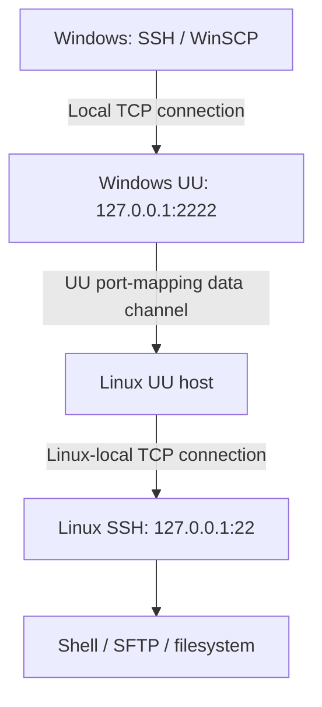

# 通过 UU 端口映射使用 SSH / WinSCP

[English](#english)

Linux 主机没有公网 IP 时，可以在 UU 已建立的连接中转发 SSH 流量，在 Windows 上用 OpenSSH 登录、用 WinSCP 通过 SFTP 传文件。已有的 UU 终端和文件传输功能可以继续使用，无需图形桌面。

端口映射是[上游已有的功能](../src/port_mapping.rs)。本 fork 补充这套配置教程、两种访问方式的网络原理对照，以及 Windows 实机验证记录；本次部署没有改动端口映射代码，也没有替换运行中的程序。

## 两种方式的数据路径

| 对比 | UU 内置终端 / 文件传输 | UU 端口映射 + SSH / SFTP |
|---|---|---|
| 跨网络连接 | UU 数据通道 | UU 数据通道 |
| 应用层协议 | UU 终端或文件协议 | SSH；文件传输使用 SSH 中的 SFTP 子系统 |
| Linux 上处理请求的程序 | 社区版 UU 创建终端会话、读写文件 | UU 转发数据，SSH 服务创建会话、通过 SFTP 读写文件 |
| 是否需要 SSH 服务 | 这些 UU 功能不需要 | 需要 |
| 与下载兼容补丁的关系 | UU 文件工具使用[该补丁修复的协议](windows-download-compatibility.md) | 不经过 UU 文件下载协议，但端口映射和 SSH 本身必须可用 |



这里有两条 TCP 连接：Windows 客户端到本机 UU，以及 Linux UU 到本机 SSH；中间由 UU 通道转发字节。它不把一条 TCP 连接原封不动地延伸到外网，也不会给 Linux 分配公网 IP。SSH 的协商、加密和用户认证仍发生在 SSH 客户端与 SSH 服务之间。

图中两个 `127.0.0.1` 分别指各自所在的电脑：Windows 端的本地入口和 Linux 端的 SSH 服务。`2222` 是可自选的本地空闲端口；`22` 是示例中的 SSH 实际监听端口。

## 1. 检查前提

- Linux 已安装并登录本项目，Windows UU 能看到对应设备在线。安装及无头服务设置见 [README](../README.md#没有显示器的服务器)。
- Linux 的 SSH 服务正常，允许所用 Linux 账号认证，且 SFTP 子系统可用。Ubuntu 可用 `systemctl status ssh --no-pager`、`ss -lnt` 检查；SSH 使用其他端口时，应在映射中填实际端口。
- 主机没有通过 `UU_PORT_MAPPING=0` 禁用端口映射。现有配置已经满足要求时，不需要重启 UU、重新扫码或改动 SSH 配置。
- Windows 已有 OpenSSH 客户端和 WinSCP，本地示例端口 `2222` 空闲。可在 PowerShell 用下面的命令查看占用；没有输出表示此时没有 TCP 监听者：

```powershell
Get-NetTCPConnection -State Listen -LocalPort 2222 -ErrorAction SilentlyContinue
```

下文 `your_linux_user` 是占位符，请替换为自己的 Linux 用户名。

## 2. 在 Windows UU 创建映射

选择 Linux 设备，打开「端口映射」，新增并启用规则：

| 字段 | 示例值 |
|---|---|
| 名称 | `Linux-SSH` |
| 本地端口 | `2222` |
| 目标地址 | `127.0.0.1` |
| 目标端口 | `22` |
| 允许局域网访问（若有此选项） | 关闭，只让本机使用 |

保持 UU 在线、映射启用。本次验收期间映射窗口保持打开；关闭窗口是否继续保留映射尚未单独验证。停止映射或退出 UU 会使这条访问路径不可用。

创建后，再运行上面的 PowerShell 命令，预期看到 `127.0.0.1:2222` 被监听。这个入口应由 UU 的 `GameViewer` 进程持有。

## 3. 在本机使用 SSH

```powershell
ssh -p 2222 your_linux_user@127.0.0.1
```

首次连接时，通过已有的可信服务器终端获取主机公钥指纹，并与客户端显示值核对。例如服务器使用 Ed25519 主机密钥时：

```sh
ssh-keygen -lf /etc/ssh/ssh_host_ed25519_key.pub
```

使用 Linux 账号密码或已配置的 SSH 密钥认证。UU 的账号登录并不代替 SSH 认证；终端输入密码时不回显字符是正常行为。登录后可运行 `hostname`、`whoami` 确认目标和用户。

可选：在 Windows 的 `%USERPROFILE%\.ssh\config` 中增加一个不与现有配置重名的条目，保留原有条目，将 `your_linux_user` 换成自己的账号：

```sshconfig
Host uu-linux
    HostName 127.0.0.1
    Port 2222
    User your_linux_user
    HostKeyAlias uu-linux
    ServerAliveInterval 30
    ServerAliveCountMax 3
```

之后执行 `ssh uu-linux`。`HostKeyAlias` 为这个目标单独记录主机身份；首次使用这个别名时仍需核对指纹。保活设置不会自动启动 UU，也不会重新建立已经断开的映射。

## 4. 用 WinSCP 传文件

在 WinSCP 新建站点：

| 字段 | 填写内容 |
|---|---|
| 文件协议 | **SFTP** |
| 主机名 | `127.0.0.1` |
| 端口号 | `2222` |
| 用户名 | 自己的 Linux 用户名 |
| 密码 | Linux 账号密码，或使用已配置的 SSH 密钥 |

核对同一服务器的主机指纹后登录，即可在本机和远端目录之间上传、下载。SFTP 复用映射到 SSH 的这条路径，不需要额外映射 FTP 端口。

也可以创建指向 `WinSCP.exe` 的 Windows 快捷方式，在目标程序后附加以下参数，并替换用户名：

```text
sftp://your_linux_user@127.0.0.1:2222/ /sessionname="Linux via UU"
```

快捷方式不填写密码，连接时输入即可。SSH 快捷方式可以指向 `ssh.exe` 并传入 `uu-linux`。这些本机配置不会自动同步到另一台 Windows；另一台电脑需要建立自己的映射和连接设置。

## 5. 复核与常见问题

| 现象 | 检查位置 |
|---|---|
| 本机 `2222` 没有监听、`Connection refused` | UU 是否运行、设备是否在线、映射是否启用、本地端口是否填对 |
| 本地入口存在，但 SSH 等待或断开 | Linux SSH 是否监听目标端口；主机日志是否出现映射连接失败 |
| `Permission denied` | Linux 用户名、密码或 SSH 密钥，以及服务器认证设置 |
| SSH 正常，WinSCP 无法连接 | 文件协议是否选 SFTP、端口是否一致、服务器 SFTP 子系统是否可用 |
| 主机密钥变化 | 先核对映射是否指向另一个设备，或服务器是否重装；重新确认真实指纹 |
| UU 提示被控端版本过低 | 核对双方版本；本页只验证下述组合，不代表所有版本兼容 |

服务器上可查看 `journalctl --user -u uuremote-native.service`。本次验收中，`Port mapping connecting: port=22 loopback=true` 后出现 `Port mapping stream open: port=22`，说明目标 TCP 连接已建立；仍需完成 SSH 登录才能确认整条链路可用。

验证文件传输时，在 Linux 用 `sha256sum`，Windows 用 `Get-FileHash -Algorithm SHA256` 比较同一测试文件。上传测试使用独立临时文件，避免覆盖业务数据。

同一局域网内可以直接使用服务器内网地址连接 SSH；异地使用这条 UU 路径时仍连接自己电脑的 `127.0.0.1:2222`。端口映射是否在异地可用，应通过电脑切换到独立网络另行验证。

## 实机验证记录：2026-11-11

| 项目 | 已观察的结果 |
|---|---|
| Linux | Ubuntu 24.04.4 LTS，ARM64，无头模式 |
| 社区端 | v0.2.57 + 本 fork 下载修复，源代码提交 `b813aad` |
| Windows 软件 | 官方 UU 4.46.0.4716、Windows OpenSSH、WinSCP 6.7 |
| 映射入口 | `127.0.0.1:2222`，由 `GameViewer` 监听 |
| SSH | 通过映射完成密码认证并执行命令；映射与可信直连看到的主机公钥一致 |
| SFTP 下载 | 42 字节文本和 1 MiB 文件，SHA-256 与源文件一致 |
| SFTP 上传 | 1 MiB 随机数据上传并下载回读，内容一致 |
| WinSCP | 通过实际 WinSCP 自动化接口完成 1 MiB 下载、上传和回读，SHA-256 一致 |
| 用户操作 | 用户亲自打开 SSH 与 WinSCP 桌面入口，确认均正常 |
| 服务影响 | 无需修改或重启服务器服务；原有 UU 功能和下载修复保留 |

以上通过当前网络中的 UU 映射实测，未将这台 Windows 切换到外网做独立验收。关闭映射窗口后的行为、目录传输、断点续传和其他版本组合未纳入本次验收。该教程没有增加运行时代码；原下载修复的 365 项测试结果见[修复记录](windows-download-compatibility.md)，不应当作本轮新跑的测试。

## English

### Purpose and architecture

Use UU's existing port-mapping capability to reach a Linux SSH server from Windows OpenSSH or WinSCP/SFTP. The Linux host does not need its own public IP or a desktop. Keep the existing UU terminal and file-transfer features available.

Port mapping was implemented upstream in [src/port_mapping.rs](../src/port_mapping.rs). This fork contributes deployment instructions and Windows acceptance evidence; this deployment required no new mapping code or server restart.

The diagram above shows two local TCP connections joined by UU's data channel: the Windows SSH client connects to the local UU listener, and the Linux UU process connects to the Linux SSH service. UU forwards bytes while SSH performs its own authentication, encryption and session handling. Each `127.0.0.1` refers to the machine on that side.

The built-in UU terminal/file tools instead use UU application messages processed directly by the Linux host. SFTP over the mapping does not use the UU file-download protocol fixed by this fork, but still requires working UU forwarding and a working SSH/SFTP service.

### Setup

1. Install and sign in to this host following [README.en.md](../README.en.md#servers-without-a-monitor). Confirm the device is online, SSH/SFTP works and port mapping has not been disabled with `UU_PORT_MAPPING=0`. On Ubuntu, `systemctl status ssh --no-pager` and `ss -lnt` help check the service and listener. Existing working services do not need a configuration change or restart.
2. In the official Windows UU viewer, select the Linux device and create an enabled port-mapping rule: name `Linux-SSH`, local port `2222`, target address `127.0.0.1`, target port `22`. Substitute the actual SSH port if different. Disable LAN access if that option is offered. Verify `Get-NetTCPConnection -State Listen -LocalPort 2222 -ErrorAction SilentlyContinue` reports a loopback listener owned by `GameViewer`.
3. Keep UU online and the rule enabled. The mapping window was left open during acceptance; behavior after closing only that window was not tested. Stopping the mapping or exiting UU removes this access path.
4. Run `ssh -p 2222 your_linux_user@127.0.0.1`, substituting your Linux username. Check the SSH host fingerprint against a trusted server session; for an Ed25519 host key, use `ssh-keygen -lf /etc/ssh/ssh_host_ed25519_key.pub` on Linux. Authenticate with the Linux password or an existing SSH key. UU login does not replace SSH authentication. Use `hostname` and `whoami` to verify the destination.
5. Optionally add the `Host uu-linux` block shown above to `%USERPROFILE%\.ssh\config`, replacing the username and retaining existing entries. Run `ssh uu-linux`. `HostKeyAlias` gives the destination a separate host-key identity; verify its fingerprint on first use. Keepalives do not start UU or recreate a stopped mapping.
6. In WinSCP, choose **SFTP**, host `127.0.0.1`, port `2222` and your Linux credentials. Verify the same host fingerprint. No additional FTP port is required. A shortcut targeting `WinSCP.exe` may use `sftp://your_linux_user@127.0.0.1:2222/ /sessionname="Linux via UU"` without embedding a password. An SSH shortcut can target `ssh.exe` with argument `uu-linux`. Repeat the local setup on each Windows computer; aliases and shortcuts do not synchronize automatically.

### Verification and troubleshooting

- No local listener / connection refused: check UU, device availability, rule activation and the chosen local port.
- Listener exists but SSH waits or disconnects: check the Linux target port and UU host logs. A `Port mapping stream open: port=22` record proves the target TCP connection opened, not that SSH authentication succeeded.
- Permission denied: check the Linux username, credentials and SSH authentication policy.
- SSH works but WinSCP does not: check SFTP selection, port and the server's SFTP subsystem.
- A changed host key requires checking the destination or server reinstall and verifying its real fingerprint. A viewer version gate requires checking both versions; acceptance below is limited to that combination.
- Compare test-file SHA-256 values with Linux `sha256sum` and Windows `Get-FileHash -Algorithm SHA256`. Use separate temporary files for upload tests.

LAN SSH can use the server's private address directly. When using the UU path from elsewhere, SSH still connects to the Windows-local `127.0.0.1:2222`; it does not directly route to the server's private IP. Test a separate network to establish off-site acceptance.

### Acceptance on 2026-11-11

The tested host was headless Ubuntu 24.04.4 LTS ARM64 running v0.2.57 plus this fork's download fix (`b813aad`). The Windows clients were official UU 4.46.0.4716, Windows OpenSSH and WinSCP 6.7.

SSH password login and commands succeeded through the UU-owned loopback listener, with the same host key as the trusted direct connection. SFTP downloaded a 42-byte text file and a 1 MiB binary file with matching source hashes; a separate 1 MiB random upload round trip matched byte for byte. The actual WinSCP automation interface also downloaded, uploaded and read back a 1 MiB file with matching SHA-256. The user opened both desktop shortcuts and confirmed they worked. No server service change or restart was needed; existing UU functionality and the download fix were retained.

Acceptance used the current network through UU. Switching this Windows computer to an independent external network, closing the mapping window, directory transfers, resume behavior and other version combinations were not tested here. This guide changes no runtime code; the earlier 365-test result belongs to the [download fix](windows-download-compatibility.md#english), not a new test run for this documentation.

## References

- [UU port-mapping implementation](../src/port_mapping.rs)
- [UU terminal implementation](../src/terminal.rs)
- [UU file-transfer implementation](../src/file_trans.rs)
- [WinSCP session URL](https://winscp.net/eng/docs/session_url)
- [WinSCP command-line options](https://winscp.net/eng/docs/commandline)
- [WinSCP .NET session options](https://winscp.net/eng/docs/library_sessionoptions)
